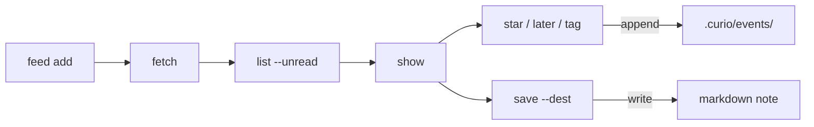

# `curio` — the CLI head

`curio` is the v1 surface of Curio: an agent-, cron-, and script-friendly
head over the `curio-core` engine. Every command is a thin adapter — the
fetch policy, sanitize-at-ingest pipeline, SQLite store, event log, and
export machinery all live in the core and behave identically under any
future head.

- Install: `cargo install --path crates/curio-cli` (Rust 1.88 or newer —
  the declared `rust-version`, enforced by CI's `msrv` job)
- **`--json` is a global flag** — pass it before or after any subcommand to
  get exactly one JSON document on stdout (read commands return their data;
  write commands return the changed/unchanged result). Parse, don't scrape.
- Diagnostics go to stderr, driven by `RUST_LOG` (e.g.
  `RUST_LOG=curio_core=debug curio fetch`).
- Errors exit non-zero with a one-line `error: …` on stderr: status **75**
  (`EX_TEMPFAIL`) when another Curio process — the desktop app, another cron
  job — kept the profile busy past the wait (nothing is wrong; retry later),
  **1** for every other failure.
- The CLI and the desktop app can run on one profile at the same time: state
  changes and the event log are serialized between them (an event is never
  lost, and lines never interleave; a rare duplicate line can appear, which
  consumers drop by `event_id`). Both heads share one destination
  registry: a destination added or removed in the desktop app is seen by
  the next CLI command, and one removed there stays removed even though
  `curio.toml` still lists it (see `curio.toml` below). The desktop app
  loads its destinations list once per session and again after its own
  changes, so a destination `curio dest add` registers while the app is
  open shows up there once the app restarts (#256).
  Refreshes of the same feed from both heads take turns.

## Commands at a glance

| Command | What it does |
|---------|--------------|
| `curio init [dir]` | Scaffold a profile (`curio.toml`, `curio.db`, events log) |
| `curio feed add <url> [--tags …]` | Subscribe — to a feed URL, or the validated feed autodiscovered from a site, page or bare domain |
| `curio feed list` / `curio feed rm <id>` | List / unsubscribe |
| `curio fetch` | Refresh every feed; reports new-article counts |
| `curio list [--unread\|--starred\|--tag …]` | List articles (keyset-paginated) |
| `curio show <id>` | Render an article as markdown in the terminal |
| `curio star` / `later` / `archive` / `tag` / `untag` `<id>` | Flip state — each is a `curio.events.v1` event |
| `curio search <query>` | Full-text search (FTS5) |
| `curio dest add <name> <path>` | Register a save destination |
| `curio save <id> --dest <name>` | Export a note per `curio.frontmatter.v1` |
| `curio import <file> --from <service>` | Import subscriptions + saved articles from a third-party export (idempotent) |
| `curio reddit login\|status\|logout` | Manage the optional BYO Reddit API credentials (OS keychain, per profile) |
| `curio events tail [-n N]` | Watch the behavioral event stream |
| `curio doctor` | DB integrity, FTS sync, events-log health |

A typical reading loop:



## The profile

All state lives in one profile directory:

| Path | Contents |
|------|----------|
| `curio.toml` | human-editable configuration (below) |
| `curio.db` | WAL SQLite: feeds, articles, state, FTS index |
| `curio.db.pre-vN.bak` | automatic snapshot taken before upgrading the database to schema `N` (the latest one plus the highest-numbered other kept; see [Upgrades and backups](#upgrades-and-backups)) |
| `.curio/events/events-YYYYMMDD.jsonl` | the `curio.events.v1` behavioral log |
| `.curio/events.lock` | the lock that lets several Curio processes share the events log (holds no data; safe to ignore, never commit) |
| `.curio/.gitignore` | scaffolded so the events log and its lock file are never committed |
| `.curio/profile-id` | the profile's opaque keychain id (created the first time a head loads Reddit credentials — every CLI command and app launch; holds no secret) |
| `set-aside/<timestamp>/` | databases the desktop recovery screen moved out of the way (never deleted; see [Upgrades and backups](#upgrades-and-backups)) |

The default profile is **shared with the desktop app** — the CLI and the
app open the same database, so `curio clip <url>` shows up in the reader
and a cron job sees the reader's library:

| Platform | Default profile |
|----------|-----------------|
| macOS | `~/Library/Application Support/io.github.alexnodeland.curio` |
| Linux | `~/.local/share/curio` (XDG-respecting: `XDG_DATA_HOME` wins) |
| Windows | `%LOCALAPPDATA%\alexnodeland\curio\data` |

Override per invocation with `--profile DIR` or persistently with
`CURIO_PROFILE=DIR` (the desktop app honours `CURIO_PROFILE` too).
`curio doctor` prints the resolved path and whether it is the shared
default.

A profile on network or sync-managed storage is refused before anything
is created or opened: NFS, SMB/CIFS, AFP and WebDAV mounts, iCloud Drive
(`~/Library/Mobile Documents`), the macOS cloud-sync folders under
`~/Library/CloudStorage` (Dropbox, OneDrive, Google Drive…), a Dropbox
folder, a Syncthing folder, or a Windows `\\server\share` path. SQLite's
locking is unsafe there and sync clients copy the database without its
write-ahead log, which corrupts it. Move the profile to a local disk, or
pass the global `--allow-network-fs` flag (or set
`CURIO_ALLOW_NETWORK_FS=1`) to open it anyway. A mapped Windows drive
letter is not recognised.

The desktop app applies the same guard: a refused profile opens on the
recovery screen, which only offers Try again (the database is healthy, so
it never offers to replace it). The app reads `CURIO_ALLOW_NETWORK_FS` as
its override, but an app started from Finder or the Dock does not inherit
your shell's environment, so set the variable for the launch itself:

```sh
open --env CURIO_ALLOW_NETWORK_FS=1 -a Curio   # this launch only
launchctl setenv CURIO_ALLOW_NETWORK_FS 1      # every app launched until you log out
```

Quit Curio first: a running app keeps the environment it started with. On
Linux and Windows, set the variable in the environment the app is started
from.

```sh
curio init                 # scaffold the default profile
curio --profile /tmp/p init  # or an explicit one (great for testing)
```

`init` is idempotent: re-running never clobbers an existing `curio.toml`.
It is also the only command that creates a profile: every other command
refuses a directory without a `curio.db` (exit 1, with a "run `curio
init`" hint), so a mistyped `--profile` can't silently show an empty
library.

**Upgrading from 0.4 or earlier.** Older CLIs used
`~/Library/Application Support/curio` on macOS (and the Windows app kept
its library in Roaming AppData). The first run of either head on the
default profile moves a lone old profile into the shared location — a
same-volume rename, so the library moves whole or not at all. Nothing is
ever merged:

- **The shared location already holds a library.** The old one stays where
  it is; every command prints a warning and `curio doctor` fails its
  `legacy-profile` check until you reconcile by hand (open the old one with
  `--profile` to export what you need, then remove it).
- **The old library can't be moved yet** — another curio process still has
  it open (a stale `curio.db-wal` left by an app that exited is not enough:
  the move checks whether any process is attached), there are two old
  libraries, or the move fails. A fresh empty library would strand the old
  one for good, so neither head creates one: every CLI command (`init`
  included) exits 1 naming the old library — quit the other process and run
  curio again, or open it with `--profile` — and the desktop app opens the
  old library where it is for that session and tries the move again at the
  next start.

The desktop app reports what it did once at startup and keeps the
explanation under Settings › Advanced.

## `curio.toml`

```toml
[settings]
default_destination = "vault"   # what `curio save` uses when --dest is omitted
politeness_delay_ms = 500       # min spacing between requests to the same host
user_agent = "curio/0.2 (+https://github.com/alexnodeland/curio-rss)"  # optional; overrides the default curio/<version> UA

[destinations]
vault = "/home/you/notes/reading"

[feeds."http://127.0.0.1:8787/digest.xml"]
allow_private_network = true    # contract W1 — see below
```

Ownership split: feeds, articles, reading state and the destination
registry live in `curio.db` (the engine's domain — don't edit);
`curio.toml` holds what a human should be able to change with a text
editor: settings, per-feed overrides, and the destinations to seed. On
every run the CLI reconciles the file into the engine: per-feed
overrides are applied, and destinations are **seeded**. Each `name = "path"` line is applied once (it registers
the destination, as `curio dest add` would). After that the line is
left alone: if the desktop app removes the destination or moves it to
another folder, the next CLI run keeps that change rather than undo it.
Editing a line to a new path applies it again, and so does deleting a
line and adding it back later. `curio dest add` always registers,
whatever happened before.

**Contract W1 (`allow_private_network`).** The fetch client is
SSRF-guarded by default: it refuses to touch loopback, RFC 1918, and
link-local addresses, re-checking every redirect hop after DNS
resolution. A per-feed `allow_private_network = true` exempts one feed —
so a localhost digest feed stays subscribable. The flag is *explicit
configuration only*: edit `curio.toml`, or pass
`--allow-private-network` to `feed add` (which writes it to `curio.toml`
for you). Nothing in feed content can ever set it.

## Feeds

```sh
curio feed add https://example.com/feed.xml --tags rust,databases
curio feed add example.com                     # bare domain → https://example.com/
curio feed add https://github.com/rust-lang/rust   # → its releases.atom
curio feed add http://127.0.0.1:8787/digest.xml --allow-private-network
curio feed add https://example.com/beta --no-validate   # as given, unfetched
curio feed list [--json]
curio feed rm example.com          # by id, exact URL, or unique substring
```

`feed add` never subscribes to something a refresh could not parse. It
takes whatever you typed — a feed URL, a site or page URL, or a bare
domain (given `https://`; a legacy `feed://` link works too; a URL with a
`user:password@` part is refused) — and
autodiscovers the feed before subscribing:

1. **Known sites, no scraping.** reddit `/r/<sub>` and `/user/<name>`,
   GitHub `<owner>/<repo>` (its releases feed), YouTube playlists and
   `/channel/UC…` pages, Mastodon `@user` profiles and Substack
   publications map straight to their feed URL.
2. **The page itself.** If the URL is a feed, that's it — subscribed as
   typed, or at its new address only when it has moved permanently (a
   temporary redirect's target is never stored). Otherwise its
   declared `<link rel="alternate">` feeds count — RSS, Atom and JSON Feed
   only; oEmbed and REST-API alternates are ignored, and comment feeds are
   dropped when the page also declares its main feed.
3. **Probing**, only when nothing is declared: feed-shaped links on the
   page, then `/feed`, `/feed.xml`, `/index.xml`, `/rss.xml`, `/atom.xml`
   and `/rss` — at most six requests in total (redirect hops count), all
   on the page's own origin: a probe that redirects to another site is
   dropped without that site ever being contacted.

Every candidate is fetched and parsed before it is offered; the first one
is subscribed (the others are listed). Discovery as a whole gives up after
45 seconds, keeping whatever validated by then. A page with no feed is refused with
a hint — `--no-validate` subscribes the URL as given, without fetching it.
`--allow-private-network` also lets discovery reach the private address,
and is recorded under the feed URL actually subscribed.

Email newsletters can be subscribed as feeds too: see
[newsletters as feeds](newsletters.md).

`feed add` emits `feed.added` (with the tags — tags-in-payload rule);
`feed rm` emits the `feed.removed` negation and keeps the articles.

```sh
curio fetch                 # refresh every active feed
curio fetch example.com     # or just one
```

`fetch` refreshes up to 8 feeds at once, so a few unreachable hosts
cost about one request timeout between them. Each host gets one feed
at a time and the hosts take turns, so a long run of one host's feeds
(40 reddit subscriptions, politeness-delayed 6.5 s apiece) never holds
the other hosts up. A feed that fails — or is unsubscribed by the
desktop app mid-run — gets an error line while every other feed still
refreshes. It reports per-feed status, in subscription
order, and new/updated article counts —
"updated" counts only entries that actually changed; a feed re-listing
identical items reports `0 updated` and rewrites no articles. The
engine does conditional GET (ETag/Last-Modified preserved on every error
path), honors permanent redirects, auto-pauses a feed forever on HTTP 410,
and stores only sanitized content — raw feed HTML never reaches the
database. An article whose full text was loaded (load-full, a feed's
full-text mode, or Reddit enrichment) keeps that body: later refreshes of
a feed still listing the item update its title and metadata, never revert
it to the feed's excerpt.

A failed refresh says why in one short line — the cause the OS or TLS stack
reported ("connection refused", "invalid peer certificate: UnknownIssuer",
"connect timeout"), or "this is a web page, not a feed — found 2 feeds on it
(first: …)" when the subscribed URL serves an HTML page. `--json` adds a
stable `error_kind` next to `error` for scripts to branch on: `invalid_url`,
`dns`, `blocked` (the SSRF guard), `refused`, `reset`, `tls_certificate`,
`tls_handshake`, `connect_timeout`, `read_timeout`, `redirect`, `too_large`,
`transport`, `http` (see `http_status`), `gone` (HTTP 410), `not_a_feed`,
`parse`, or `busy` (another Curio process was refreshing the feed).

Sloppy feeds are normalized on the way in. An entry with no publication
date takes its last-updated date, and a date in the future is clamped to
when Curio first saw the article (the future value itself is not kept; if
the feed later corrects the date, the next refresh stores the correction).
Items that reuse one guid for different links are stored as separate
articles, each keeping its article from one refresh to the next even as
the feed starts or stops reusing the guid, and an item listed twice is
stored once. Relative lead images are resolved instead of dropped: a
`media:thumbnail` against the entry link (else the feed URL), the way the
entry's inline images are; an image enclosure or `media:content` against
its `xml:base`, else the feed URL. An entry with no link of its own
records the feed URL as its source, and full-text mode never fetches it.

```sh
curio opml import subscriptions.opml   # folders become tags; known URLs skipped
curio opml export backup.opml          # "-" writes to stdout
```

Bring a whole library over from another reader with one idempotent command —
feeds become subscriptions, saved articles become read-later items with their
tags:

```sh
curio import subscriptions.opml --from opml         # --from defaults to opml
curio import pocket-export.csv   --from pocket       # Pocket / Instapaper / Readwise CSV
```

Imports are lenient about messy real-world exports. Files up to 50 MiB are
read in whatever encoding they were written in (a byte-order mark, an XML
`encoding="…"` declaration, BOM-less UTF-16 as Excel writes it, otherwise
UTF-8 with a Windows-1252 fallback). OPML with HTML entities (`&nbsp;`,
`&eacute;`) or bare `&` in titles imports; an outline that cannot be read at
all is skipped, not fatal. Every URL is trimmed, `feed://…` / `feed:https://…`
become `https://…`, anything that is not `http(s)` (`webcal:`, `javascript:`)
is dropped, and duplicates are matched on the normalized URL — so re-importing
a file adds nothing. Dropped rows are counted (`… N invalid`), each named on
stderr, by both `curio import` and `curio opml import`; with `--json` they
come back as `feeds_invalid` / `articles_invalid` (`invalid` for `curio opml
import`) plus a `rejected` list of `{kind, reason, detail}` (`reason`:
`malformed`, `invalid_url` or `unsupported_scheme`) — the first 100 rows,
while the counts stay exact. `curio opml export` replaces its
target atomically, so a failed write never truncates the previous file.

**Per-host fetch policy.** A few hosts fingerprint-block the honest `curio`
User-Agent + rustls TLS. `curio-core` carries a built-in per-host override
(matched by host suffix): `reddit.com` (and `*.reddit.com`) automatically get
a browser-class User-Agent, the platform-native TLS stack, and a longer 2 s
politeness delay — so `curio fetch` of a subreddit `.rss` works out of the box.
This override is hard-coded in the engine (not a `curio.toml` knob) and is
disclosed in [PRIVACY.md](../PRIVACY.md); every other host keeps rustls + the
honest `curio/<version>` UA and the default 500 ms delay.

**Reddit API credentials (optional).** Reddit enrichment works
unauthenticated, slowly. Bring your own free app from reddit.com/prefs/apps
(type "script") and Curio uses the authenticated API at the faster tier:

```sh
curio reddit login --client-id <id>   # reads the secret from stdin (keeps it out of shell history)
curio reddit status                   # configured? and the client id — never the secret
curio reddit logout                   # remove them; back to unauthenticated
```

The credentials live in the OS keychain, **one item per profile**: `--profile`
(or `CURIO_PROFILE`) selects whose app a command — including a cron
`curio fetch` — uses, and two profiles can hold different apps. Note that the
CLI's default profile is not the desktop app's, so credentials saved in the
app are not seen by a bare `curio fetch` unless you point `--profile` at the
app's profile directory. The keychain item is keyed by the id in
`.curio/profile-id`, so moving a profile directory keeps its credentials.
Upgrading from 0.4.x, the old shared item is copied into each profile the
first time it opens; `reddit logout` removes it.

When Reddit refuses a full post for auth reasons, the error says which of
four things happened: **no credentials** (Reddit blocks anonymous full-post
requests — `reddit login`), **credentials refused** (the token endpoint
turned the client id or secret down — check them, or re-create the app),
**token refused** (the credentials were accepted but Reddit refused the token
they were traded for — the app's access was likely revoked; the token is
dropped and the next request asks for a new one), or **token unavailable**
(credentials are installed, but the token endpoint failed, timed out or was
unreachable — usually a Reddit outage; nothing to fix, try again later).

## Reading

```sh
curio list [--unread] [--starred] [--read-later] [--tag rust] [--feed example.com] [--limit 20]
curio search "sqlite wal" [--limit 20]    # real FTS5, hostile input escaped
curio show 3e9f10aa                       # article as markdown; marks it read
curio open 3e9f10aa                       # emits article.opened, launches $BROWSER
```

Article handles are **any unique fragment of the `curio_id`** — listings
show the 8-character tail, which is the typable handle. (UUIDv7 ids share
their leading timestamp bits within a fetch batch, so a leading prefix
needs to be much longer; use the tail.) Ambiguous or unknown fragments
fail with a helpful message.

`open` uses `$BROWSER` when set, else the platform opener (`open` /
`xdg-open`). The `article.opened` event is written first — the record is
the point.

## State

```sh
curio star 3e9f10aa      # article.starred          curio unstar …  # article.unstarred
curio later 3e9f10aa     # article.read_later.added curio unlater … # article.read_later.removed
curio archive 3e9f10aa   # article.archived         curio unarchive …
curio tag 3e9f10aa rust  # article.tagged           curio untag … rust
```

Every flip is idempotent: re-starring a starred article changes nothing
and emits nothing (`"changed": false` in JSON). Negation events remove
membership when the stream is folded — histories are not monotone, per
the events contract.

## Saving to destinations

A destination is a named directory of markdown + YAML — your notes vault,
a git repo, anything. Paths enter the system exactly once, at
registration; everything else refers to destinations by name.

```sh
curio dest add vault ~/notes/reading
curio dest list
curio save 3e9f10aa --dest vault     # or set settings.default_destination
```

`save` writes a `curio.frontmatter.v1` note (machine frontmatter + the
marked managed region) and updates the destination's
`.curio/manifest.json` — note first, manifest second, both via atomic
rename. Export is idempotent on `(curio_id, checksum)`:

- first save → `created`, emits `article.saved`
- content changed since → `updated`, emits `article.updated`, replaces
  only the frontmatter machine keys and the managed region — everything
  you wrote outside the markers survives byte-for-byte
- unchanged → `unchanged`, writes nothing, emits nothing; if the note on
  disk is blank (emptied by a crash or a sync tool) it is quietly
  rewritten, and if it no longer parses as a Curio note (frontmatter or
  markers edited away, or bytes that are not even UTF-8) the save fails
  with a parse error instead of claiming it is intact

Bulk saves (`curio save --all --dest vault`, or a filter such as
`--read-later`) run every article through the same steps and stop at the
first one that fails — including a note that no longer parses, even if
its content has not changed. Notes saved before it stay saved; repair or
delete the offending note and re-run (already-exported notes come back
`unchanged`).

Notes land at `curio/<slug>.md`, where the slug is the title lowercased,
NFC-normalized and dash-separated, capped at 100 bytes so the name fits
every filesystem's 255-byte limit even with a dedup suffix
(`<slug>-<id prefix>.md` when another article already owns the name — in
the manifest, or because the note already on disk there belongs to a
different `curio_id`). Titles that would be a Windows device name (`con`,
`nul`, `com1`, …) get a `-note` suffix. Every write is flushed to disk
(`fsync` on the file and its directory) before the manifest records it,
and a failed write leaves no temp file behind. On filesystems that cannot
flush at all (some network shares, exFAT, FUSE mounts) the flush is
skipped rather than failing the save.

The manifest is a file in your folder, so Curio never trusts it alone:

- **A note is only rewritten for the article it belongs to** — the
  note's own frontmatter `curio_id` decides. If the manifest was lost,
  reset or restored from an old commit, a second "Weekly links" article
  gets `curio/weekly-links-<id-prefix>.md` instead of taking over the first
  one's note, and a file of your own at a slug path is never touched
  (a blank one — empty or whitespace only — holds nothing to keep, so it
  counts as free).
  An article whose own note is already there is reconciled onto it and
  reported as `updated` (never a second `created`).
- **One export per destination at a time**, across threads and processes
  (the CLI next to the desktop app): exports queue on an advisory lock,
  `.curio/manifest.lock` (gitignored, never deleted — it holds no data).
  An `unchanged` export writes nothing and takes no lock, so it works on
  a read-only folder too; on a network or FUSE mount without advisory
  locks Curio warns and serializes within its own process only.
- **A vanished vault is refused, not recreated.** If the destination
  folder is gone — or, once it has been exported to, its `.curio/` folder
  is — `save` fails with "destination folder … is missing" instead of
  re-exporting everything into an empty folder at the old path. Every
  command re-applies `curio.toml`'s destinations, but that never
  recreates such a folder. Reconnect the drive, or run `curio dest add
  <name> <path>` again (new or same path) to start the destination
  afresh; changing a destination's path in `curio.toml` does the same.
- **A folder Curio cannot access, or a full disk, says so.** An export
  that hits a permission refusal or a read-only volume fails with "cannot
  access … permission denied or read-only"; one that runs out of disk
  space (or quota) fails with "the disk holding … is full". Notes are
  written atomically, so the previous version of the note is kept intact;
  fix the permissions or free some space and export again.
- **Sync-tool conflict copies** of the manifest (`manifest (conflicted
  copy).json`, iCloud's `manifest 2.json`, Syncthing's
  `manifest.sync-conflict-….json`, OneDrive's `manifest-HOSTNAME.json`)
  are merged back on the next export — union of the entries, the newest
  `exported_at` wins — and then removed. If the union gives one note path
  to two articles, the note's own `curio_id` keeps its entry; the other
  article gets a path of its own on its next export. Other files in
  `.curio/` (a `manifest.backup.json` of your own) are never touched.

## Events

```sh
curio events tail -n 20 [--json]
```

A debug view of the `curio.events.v1` stream: with `--json` you get the
envelopes exactly as they appear on disk (ULID `event_id`, millisecond
UTC `ts`, `type` + `payload`). Consumers should read the files directly —
`.curio/events/events-YYYYMMDD.jsonl`, append-only, rotated daily or at
50 MB, retained ≥ 90 days — and dedupe by `event_id`. See
[design/contracts-draft.md](design/contracts-draft.md) for the full
contract and [../schemas/](../schemas/) for the machine-readable schemas.

## Doctor

```sh
curio doctor [--json]
```

Health probes over the durable surfaces, exit code 1 if any fail:
schema version, `PRAGMA integrity_check`, FTS5-index/content sync,
events-log parseability, the events `.gitignore` scaffold, staged
event intents (a non-empty set means emission was interrupted — a crash,
or a flush that failed on a full disk or an unwritable events directory;
the change itself is already stored, and the next command, or the next
open, replays the staged events into the log — an events directory that
cannot be opened at all does not stop the profile from opening, it only
keeps the events staged until it is writable again), and quarantined intents
(`dead-intents`: staged rows whose envelope no longer decoded — they are
moved to `curio.db`'s `event_intents_dead` table so they stop blocking
every open and emit, and their events never reached the log).

## Upgrades and backups

Opening a profile whose database was written by an older Curio upgrades
it in place, after first writing a consistent snapshot next to it:
`curio.db.pre-vN.bak`, where `N` is the schema version being upgraded
to (the one just written and the highest-numbered other are kept — a
rollback to an older build never prunes its own fresh backup). The
upgrade runs as one transaction: if any step fails, the database stays
exactly at its old version and the open fails with a message naming the
backup. Two Curio processes upgrading the same profile at once (the
desktop app and a scheduled `curio`) are safe: each writes its snapshot
under its own temporary name, and the upgrade itself runs once, under
the database's write lock. A database written by a
*newer* Curio is refused untouched (update Curio instead), as is a file
that is not a Curio database at all.

To roll back by hand: quit every Curio process, delete `curio.db-wal`
and `curio.db-shm` if present, then copy the backup over `curio.db`.

The desktop app does this for you. When the profile won't open (a
corrupt or too-new database, a lock held by another copy, an unwritable
data folder, a failed upgrade), it shows a recovery screen instead of
quitting, and logs the cause to `logs/curio.log.*`. From there you can
try again, restore the newest backup this version can open, start fresh,
show the profile folder, copy the error, or quit; for a database a newer
Curio wrote, it first offers to check for updates. Restoring and starting
fresh never delete anything: the current `curio.db` (and its `-wal` /
`-shm` files) is first moved to `set-aside/<UTC timestamp>/` inside the
profile, all or nothing — if any file can't be moved, the ones already
moved go back. When the database is fine but the rest of the profile
isn't (an unwritable `.curio/events` log, say), the screen only offers
to try again once you've fixed it: replacing a healthy database would
not help.
